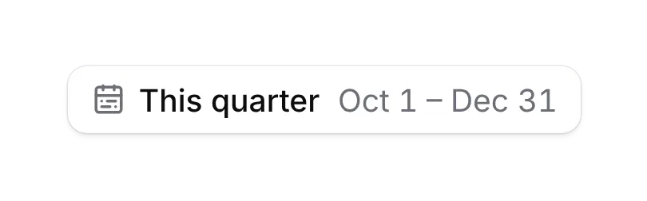
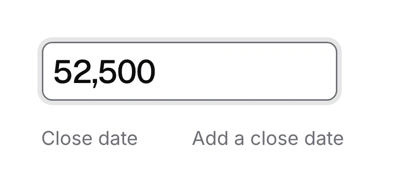
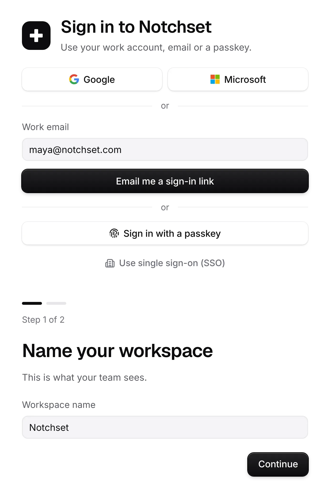
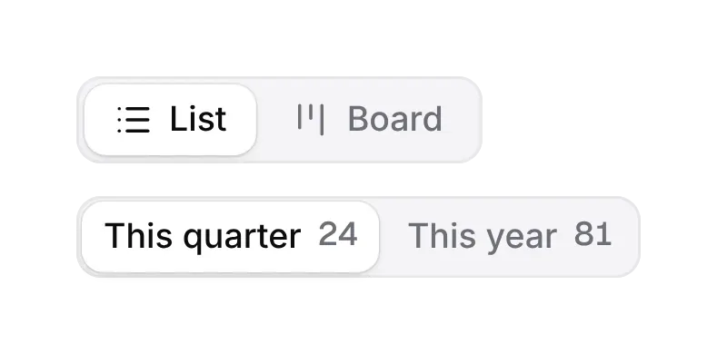

# Notchset: free React components and blocks for shadcn/ui

63 components and 16 blocks for shadcn/ui and React, free under the MIT license: the open part of **Notchset**, complete application UI for shadcn/ui. The finished app templates (CRM and Task Management) and the app blocks they're built from are Pro, at [notchset.dev/pricing](https://notchset.dev/pricing).

[Website](https://notchset.dev) · [Components](https://notchset.dev/components) · [Docs](https://notchset.dev/docs/installation) · [Pricing](https://notchset.dev/pricing) · [llms.txt](https://notchset.dev/llms.txt) for AI agents

Every piece reads your shadcn tokens through one foundation of roles (colour, type, space, sizes, motion), so it fits your app's palette, works in light and dark, and asks for less motion when the device does. Browse them live, with their props and usage, at **[notchset.dev](https://notchset.dev)**.

<p align="center">
<a href="https://notchset.dev/components/date-range-picker"><picture><source media="(prefers-color-scheme: dark)" srcset=".github/assets/date-range-picker-dark.webp"></picture></a>
<a href="https://notchset.dev/components/command-menu"><picture><source media="(prefers-color-scheme: dark)" srcset=".github/assets/command-menu-dark.webp"></picture></a>
<a href="https://notchset.dev/components/inline-edit"><picture><source media="(prefers-color-scheme: dark)" srcset=".github/assets/inline-edit-dark.webp"></picture></a>
<a href="https://notchset.dev/components/sign-in"><picture><source media="(prefers-color-scheme: dark)" srcset=".github/assets/sign-in-dark.webp"></picture></a>
<a href="https://notchset.dev/components/segmented-control"><picture><source media="(prefers-color-scheme: dark)" srcset=".github/assets/segmented-control-dark.webp"></picture></a>
<a href="https://notchset.dev/components/toast"><picture><source media="(prefers-color-scheme: dark)" srcset=".github/assets/toast-dark.webp"></picture></a>
</p>

## Install

In a React 18.3 or 19 app on Tailwind CSS v4 with a `components.json` (`npx shadcn@latest init`), any shadcn style:

```bash
npx shadcn@latest add https://notchset.dev/r/button.json
```

Or add the registry to `components.json` once and install by name:

```json
{ "registries": { "@notchset": "https://notchset.dev/r/{style}/{name}.json" } }
```

```bash
npx shadcn@latest add @notchset/button @notchset/date-picker
```

Components land in `components/ui/notchset/` as source you own; the first install merges the foundation's CSS into your global stylesheet. Tested on every release in Next.js and Vite, React 18.3 and 19, with pnpm and npm: [notchset.dev/docs/installation](https://notchset.dev/docs/installation).

## Components

| Component | What it is | Install |
|---|---|---|
| [Activity heatmap](https://notchset.dev/components/activity-heatmap) | When work happens, as working days by week. | `npx shadcn@latest add https://notchset.dev/r/activity-heatmap.json` |
| [Avatar stack](https://notchset.dev/components/avatar-stack) | Who is on something, overlapping, then +N. | `npx shadcn@latest add https://notchset.dev/r/avatar-stack.json` |
| [Avatar](https://notchset.dev/components/avatar) | A person's photo, or their initials on their own hue. | `npx shadcn@latest add https://notchset.dev/r/avatar.json` |
| [Banner](https://notchset.dev/components/banner) | What the reader should know before acting, with one fix. | `npx shadcn@latest add https://notchset.dev/r/banner.json` |
| [Bottom sheet](https://notchset.dev/components/bottom-sheet) | A phone's short set of choices, in thumb reach. | `npx shadcn@latest add https://notchset.dev/r/bottom-sheet.json` |
| [Brand lockup](https://notchset.dev/components/brand-lockup) | The brand drawn once: the plus and the lowercase wordmark. | `npx shadcn@latest add https://notchset.dev/r/brand-lockup.json` |
| [Breadcrumb and back](https://notchset.dev/components/breadcrumb) | Where a page sits, said once; one Back on a phone. | `npx shadcn@latest add https://notchset.dev/r/breadcrumb.json` |
| [Button](https://notchset.dev/components/button) | The one action shape: secondary, primary, ghost, danger. | `npx shadcn@latest add https://notchset.dev/r/button.json` |
| [Calendar](https://notchset.dev/components/calendar) | The month grid the date pickers share; months and years a press away. | `npx shadcn@latest add https://notchset.dev/r/calendar.json` |
| [Card](https://notchset.dev/components/card) | A section of a page on the panel surface. | `npx shadcn@latest add https://notchset.dev/r/card.json` |
| [Chart](https://notchset.dev/components/chart) | The parts every chart is drawn with, in the ink style. | `npx shadcn@latest add https://notchset.dev/r/chart.json` |
| [Checkbox](https://notchset.dev/components/checkbox) | A box you tick; tone done fills green and pops once. | `npx shadcn@latest add https://notchset.dev/r/checkbox.json` |
| [Chip](https://notchset.dev/components/chip) | One applied filter or picked value, with its own remove. | `npx shadcn@latest add https://notchset.dev/r/chip.json` |
| [Combobox](https://notchset.dev/components/combobox) | Pick one of a long list by typing. | `npx shadcn@latest add https://notchset.dev/r/combobox.json` |
| [Command menu](https://notchset.dev/components/command-menu) | Go anywhere or do anything by typing (⌘K). | `npx shadcn@latest add https://notchset.dev/r/command-menu.json` |
| [Company mark](https://notchset.dev/components/company-mark) | A company's colour as a rounded square with its initial. | `npx shadcn@latest add https://notchset.dev/r/company-mark.json` |
| [Date picker](https://notchset.dev/components/date-picker) | Shortcuts beside a calendar, or type the date in words. | `npx shadcn@latest add https://notchset.dev/r/date-picker.json` |
| [Date range picker](https://notchset.dev/components/date-range-picker) | A report's period: presets first, or a start and an end. | `npx shadcn@latest add https://notchset.dev/r/date-range-picker.json` |
| [Dialog](https://notchset.dev/components/dialog) | One focused step that needs an answer before you go on. | `npx shadcn@latest add https://notchset.dev/r/dialog.json` |
| [Empty state](https://notchset.dev/components/empty-state) | What goes here, and the one way to fill it. | `npx shadcn@latest add https://notchset.dev/r/empty-state.json` |
| [Field](https://notchset.dev/components/field) | A label above a control, then a hint or the error. | `npx shadcn@latest add https://notchset.dev/r/field.json` |
| [Filter button](https://notchset.dev/components/filter-button) | One facet of a list: dashed until used, then solid with a count. | `npx shadcn@latest add https://notchset.dev/r/filter-button.json` |
| [Hover momentum](https://notchset.dev/components/hover-momentum) | A card's recent activity, only when you ask. | `npx shadcn@latest add https://notchset.dev/r/hover-momentum.json` |
| [Icon button](https://notchset.dev/components/icon-button) | A square button with one icon and a required label. | `npx shadcn@latest add https://notchset.dev/r/icon-button.json` |
| [Inline bar](https://notchset.dev/components/inline-bar) | A thin bar in a table cell, with its number beside it. | `npx shadcn@latest add https://notchset.dev/r/inline-bar.json` |
| [Inline edit](https://notchset.dev/components/inline-edit) | Change a value where you read it. | `npx shadcn@latest add https://notchset.dev/r/inline-edit.json` |
| [Keyboard hint](https://notchset.dev/components/keyboard-hint) | Keycaps for a shortcut the app binds. | `npx shadcn@latest add https://notchset.dev/r/keyboard-hint.json` |
| [Line figure](https://notchset.dev/components/line-figure) | A hairline drawing that means something, drawn in once. | `npx shadcn@latest add https://notchset.dev/r/line-figure.json` |
| [Menu](https://notchset.dev/components/menu) | A thing's actions, from a button; a sheet on a phone. | `npx shadcn@latest add https://notchset.dev/r/menu.json` |
| [Message](https://notchset.dev/components/message) | One turn of a conversation, with its whole life designed. | `npx shadcn@latest add https://notchset.dev/r/message.json` |
| [Meter](https://notchset.dev/components/meter) | How much is used or done, as a thin bar beside the number. | `npx shadcn@latest add https://notchset.dev/r/meter.json` |
| [Model selector](https://notchset.dev/components/model-selector) | Which model answers, named by what it's for. | `npx shadcn@latest add https://notchset.dev/r/model-selector.json` |
| [Orb](https://notchset.dev/components/orb) | The assistant's lamp: what it is doing, with a word under it. | `npx shadcn@latest add https://notchset.dev/r/orb.json` |
| [Person card](https://notchset.dev/components/person-card) | Who someone is, on hover or focus of their face or name. | `npx shadcn@latest add https://notchset.dev/r/person-card.json` |
| [Priority mark](https://notchset.dev/components/priority-mark) | How much a task matters, readable without colour. | `npx shadcn@latest add https://notchset.dev/r/priority-mark.json` |
| [Prompt input](https://notchset.dev/components/prompt-input) | Where you ask: send, stop, queue, dictate, and keep the draft. | `npx shadcn@latest add https://notchset.dev/r/prompt-input.json` |
| [Property pill](https://notchset.dev/components/property-pill) | One property of a record as a small control that opens its picker. | `npx shadcn@latest add https://notchset.dev/r/property-pill.json` |
| [Radio cards](https://notchset.dev/components/radio-cards) | One choice from a few, each with a line to explain it. | `npx shadcn@latest add https://notchset.dev/r/radio-cards.json` |
| [Reason popover](https://notchset.dev/components/reason-popover) | One line of why, asked where the step was pressed. | `npx shadcn@latest add https://notchset.dev/r/reason-popover.json` |
| [Recipient field](https://notchset.dev/components/recipient-field) | Who an email goes to, a chip per person. | `npx shadcn@latest add https://notchset.dev/r/recipient-field.json` |
| [Reveal](https://notchset.dev/components/reveal) | A row your action adds grows in; one you remove folds away. | `npx shadcn@latest add https://notchset.dev/r/reveal.json` |
| [Rolling number](https://notchset.dev/components/rolling-number) | A figure you changed rolls only the digits that moved. | `npx shadcn@latest add https://notchset.dev/r/rolling-number.json` |
| [Search field](https://notchset.dev/components/search-field) | Filters the page as you type; Esc clears. | `npx shadcn@latest add https://notchset.dev/r/search-field.json` |
| [Secret reveal](https://notchset.dev/components/secret-reveal) | A secret shown the one time, with one Copy. | `npx shadcn@latest add https://notchset.dev/r/secret-reveal.json` |
| [Segmented control](https://notchset.dev/components/segmented-control) | Two to five views of the same thing; one always chosen. | `npx shadcn@latest add https://notchset.dev/r/segmented-control.json` |
| [Select](https://notchset.dev/components/select) | Pick one of a short, known list. | `npx shadcn@latest add https://notchset.dev/r/select.json` |
| [Side panel](https://notchset.dev/components/side-panel) | A record beside its list; J and K step through. | `npx shadcn@latest add https://notchset.dev/r/side-panel.json` |
| [Skeleton reveal](https://notchset.dev/components/skeleton-reveal) | The shape of what's coming, then the real rows with no jump. | `npx shadcn@latest add https://notchset.dev/r/skeleton-reveal.json` |
| [Skeleton](https://notchset.dev/components/skeleton) | The shape of text that is still loading. | `npx shadcn@latest add https://notchset.dev/r/skeleton.json` |
| [Sortable header](https://notchset.dev/components/sortable-header) | A column you can sort by, its natural way first. | `npx shadcn@latest add https://notchset.dev/r/sortable-header.json` |
| [Sparkline](https://notchset.dev/components/sparkline) | A trend at a glance: a line, or bars per period. | `npx shadcn@latest add https://notchset.dev/r/sparkline.json` |
| [Spinner](https://notchset.dev/components/spinner) | The notch: inline working, beside the words that say it. | `npx shadcn@latest add https://notchset.dev/r/spinner.json` |
| [Stage path](https://notchset.dev/components/stage-path) | Where a record is in its process, and the way to move it. | `npx shadcn@latest add https://notchset.dev/r/stage-path.json` |
| [State bar](https://notchset.dev/components/state-bar) | Where things sit right now, as one stacked bar with every count written. | `npx shadcn@latest add https://notchset.dev/r/state-bar.json` |
| [Status glyph](https://notchset.dev/components/status-glyph) | Where a task is, by shape; done is the one colour. | `npx shadcn@latest add https://notchset.dev/r/status-glyph.json` |
| [Status pill](https://notchset.dev/components/status-pill) | A record's state as a word with a dot in its colour. | `npx shadcn@latest add https://notchset.dev/r/status-pill.json` |
| [Switch](https://notchset.dev/components/switch) | A setting that takes effect the moment it flips. | `npx shadcn@latest add https://notchset.dev/r/switch.json` |
| [Tabs](https://notchset.dev/components/tabs) | A list's saved slices, each with its count. | `npx shadcn@latest add https://notchset.dev/r/tabs.json` |
| [Text field and text area](https://notchset.dev/components/text-field) | A native input or textarea in the system's well. | `npx shadcn@latest add https://notchset.dev/r/text-field.json` |
| [Tick bar](https://notchset.dev/components/tick-bar) | How far toward a target, as a row of thin ticks. | `npx shadcn@latest add https://notchset.dev/r/tick-bar.json` |
| [Time picker](https://notchset.dev/components/time-picker) | Type a time any way, or pick one from the list. | `npx shadcn@latest add https://notchset.dev/r/time-picker.json` |
| [Toast](https://notchset.dev/components/toast) | What just happened, with the one way back. | `npx shadcn@latest add https://notchset.dev/r/toast.json` |
| [Tooltip](https://notchset.dev/components/tooltip) | A label for something with no words of its own. | `npx shadcn@latest add https://notchset.dev/r/tooltip.json` |

## Blocks

| Block | What it is | Install |
|---|---|---|
| [Activity feed](https://notchset.dev/components/activity-feed) | What happened on a record, newest first, grouped by day. | `npx shadcn@latest add https://notchset.dev/r/activity-feed.json` |
| [Check list and ask tags](https://notchset.dev/components/check-list) | A thing measured against rules, one line per rule. | `npx shadcn@latest add https://notchset.dev/r/check-list.json` |
| [Command bar](https://notchset.dev/components/command-bar) | Say it in plain words; see what it will do before it does it. | `npx shadcn@latest add https://notchset.dev/r/command-bar.json` |
| [Data table](https://notchset.dev/components/data-table) | Rows you scan, sort, select and open. | `npx shadcn@latest add https://notchset.dev/r/data-table.json` |
| [Hero orb](https://notchset.dev/components/hero-orb) | The assistant's lamp at hero size, playing a conversation itself. | `npx shadcn@latest add https://notchset.dev/r/hero-orb.json` |
| [Live activity bar](https://notchset.dev/components/live-activity-bar) | The next thing on your day, counting down above the tab bar. | `npx shadcn@latest add https://notchset.dev/r/live-activity-bar.json` |
| [Notch island](https://notchset.dev/components/notch-island) | A dark island that becomes what just happened. | `npx shadcn@latest add https://notchset.dev/r/notch-island.json` |
| [One pipeline, five shapes](https://notchset.dev/components/pipeline-shapes) | The same deals as a board, list, forecast, month and people. | `npx shadcn@latest add https://notchset.dev/r/pipeline-shapes.json` |
| [Drop a deal, the quarter answers](https://notchset.dev/components/quarter-drop) | Move a deal and the totals, quota bar and ring answer. | `npx shadcn@latest add https://notchset.dev/r/quarter-drop.json` |
| [Scrub chart](https://notchset.dev/components/scrub-chart) | Drag across the year; the headline follows. | `npx shadcn@latest add https://notchset.dev/r/scrub-chart.json` |
| [Settings layout](https://notchset.dev/components/settings-layout) | Sections beside the open one; rows that take effect at once. | `npx shadcn@latest add https://notchset.dev/r/settings-layout.json` |
| [Share this view](https://notchset.dev/components/share-view) | The Share pill opens into its panel, in place. | `npx shadcn@latest add https://notchset.dev/r/share-view.json` |
| [Showcase wall](https://notchset.dev/components/showcase-wall) | Live pieces on soft washes, each named for what touch does. | `npx shadcn@latest add https://notchset.dev/r/showcase-wall.json` |
| [Sign in and onboarding step](https://notchset.dev/components/sign-in) | A link for anyone, a passkey for an account you have. | `npx shadcn@latest add https://notchset.dev/r/sign-in.json` |
| [Sign to close](https://notchset.dev/components/sign-to-close) | Sign the order form; the deal turns Won. | `npx shadcn@latest add https://notchset.dev/r/sign-to-close.json` |
| [Stage checklist](https://notchset.dev/components/stage-checklist) | What a step usually needs, ticking itself as it comes true. | `npx shadcn@latest add https://notchset.dev/r/stage-checklist.json` |

## What's here

- `registry/`: the source of every free item, with the foundation, the theme and the shared helpers it uses.
- `public/r/`: the same items as shadcn registry JSON, ready to serve from your own host.
- `registry.json`: the shadcn registry manifest.

This repository is published from the Notchset site on every release, so changes land on the site first. Issues and ideas are welcome.

## Pro

The rest of the system, and the templates built from it, are part of [Notchset Pro](https://notchset.dev/pricing).

## License

MIT. See [LICENSE](./LICENSE).
