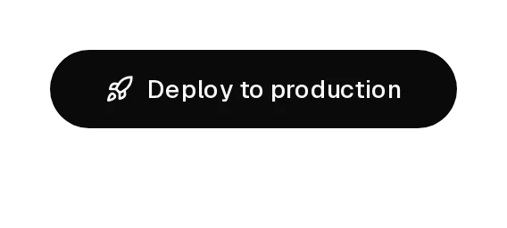
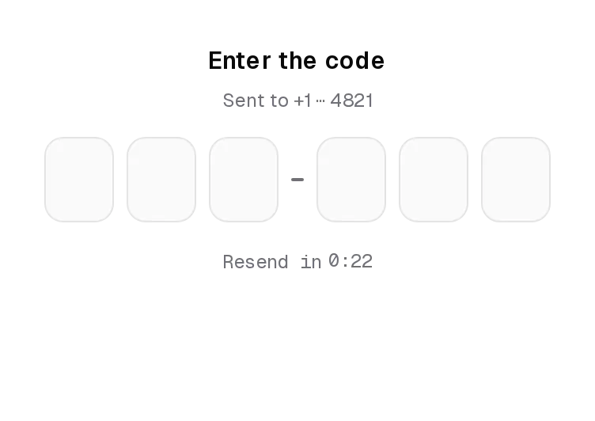
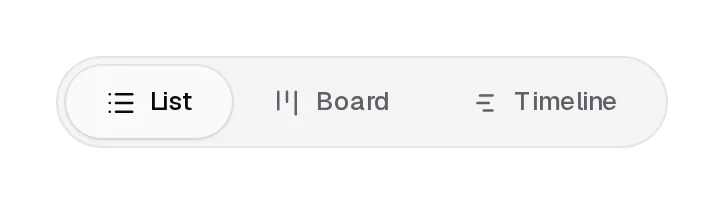
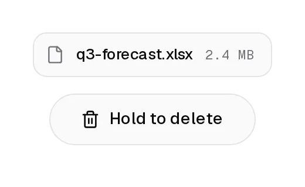
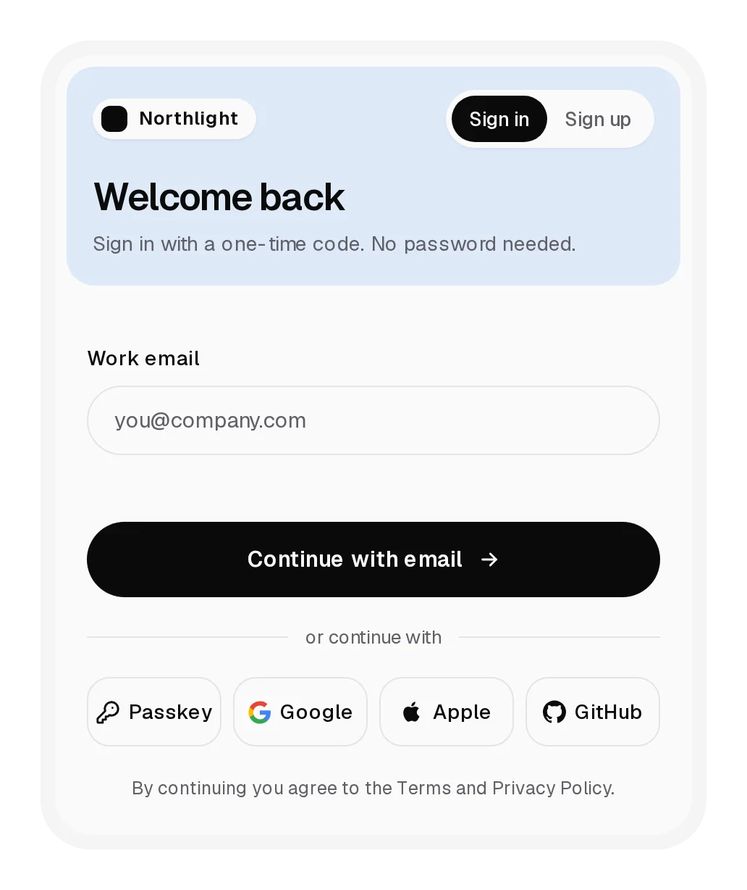
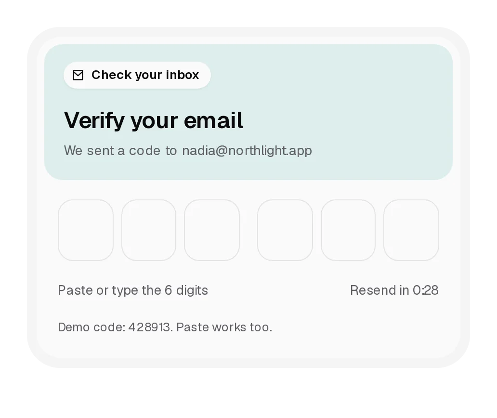

# Notchset (free components)

119 components and 3 blocks for shadcn/ui, from **Notchset**.

Browse them live, with props, usage and accessibility notes, at **[notchset.dev](https://notchset.dev)**.

<p align="center">
<a href="https://notchset.dev/components/deploy-button"><picture><source media="(prefers-color-scheme: dark)" srcset=".github/assets/deploy-button-dark.webp"></picture></a>
<a href="https://notchset.dev/components/otp-input"><picture><source media="(prefers-color-scheme: dark)" srcset=".github/assets/otp-input-dark.webp"></picture></a>
<a href="https://notchset.dev/components/inchworm-tabs"><picture><source media="(prefers-color-scheme: dark)" srcset=".github/assets/inchworm-tabs-dark.webp"></picture></a>
<a href="https://notchset.dev/components/hold-delete-button"><picture><source media="(prefers-color-scheme: dark)" srcset=".github/assets/hold-delete-button-dark.webp"></picture></a>
<a href="https://notchset.dev/components/sign-in-block"><picture><source media="(prefers-color-scheme: dark)" srcset=".github/assets/sign-in-block-dark.webp"></picture></a>
<a href="https://notchset.dev/components/verify-code-block"><picture><source media="(prefers-color-scheme: dark)" srcset=".github/assets/verify-code-block-dark.webp"></picture></a>
</p>

## Install

With the shadcn CLI (React 18.3 or 19, Tailwind CSS v4, Base UI or Radix projects):

```bash
npx shadcn@latest add https://notchset.dev/r/button.json             # Base UI build
npx shadcn@latest add https://notchset.dev/r/radix-nova/button.json  # Radix build
```

Or add the registry to `components.json` once and install by name:

```json
{ "registries": { "@notchset": "https://notchset.dev/r/{style}/{name}.json" } }
```

```bash
npx shadcn@latest add @notchset/button
```

## Components

| Component | What it is | Install |
|---|---|---|
| [Button](https://notchset.dev/components/button) | shadcn's Button, flat, with a press that overshoots on release and a tick you can hear. | `npx shadcn@latest add https://notchset.dev/r/button.json` |
| [Save Button](https://notchset.dev/components/save-button) | Save that rolls to Saving, draws a check when your promise resolves, and shakes if it fails. | `npx shadcn@latest add https://notchset.dev/r/save-button.json` |
| [Upload Button](https://notchset.dev/components/upload-button) | The button fills as your upload's bytes go out, counts the percent, then draws a check. | `npx shadcn@latest add https://notchset.dev/r/upload-button.json` |
| [Sync Button](https://notchset.dev/components/sync-button) | Arrows spin while the synced count climbs with rising ticks, then it settles on Up to date. | `npx shadcn@latest add https://notchset.dev/r/sync-button.json` |
| [Deploy Button](https://notchset.dev/components/deploy-button) | The label turns into your pipeline, a segment per stage, and lands on a live pulse. | `npx shadcn@latest add https://notchset.dev/r/deploy-button.json` |
| [Split Button](https://notchset.dev/components/split-button) | Publish with a menu of related actions; each one rolls its own words and lands its own outcome. | `npx shadcn@latest add https://notchset.dev/r/split-button.json` |
| [Inchworm Tabs](https://notchset.dev/components/inchworm-tabs) | Segmented tabs whose indicator inches over, leading edge first, with icons that draw in. | `npx shadcn@latest add https://notchset.dev/r/inchworm-tabs.json` |
| [Hold to Delete](https://notchset.dev/components/hold-delete-button) | Hold to delete: red fills the button and the lid lifts; let go early and it springs back. | `npx shadcn@latest add https://notchset.dev/r/hold-delete-button.json` |
| [Confirm Morph](https://notchset.dev/components/confirm-morph) | A button that splits into Keep and Discard, then cancels itself if nobody chooses. | `npx shadcn@latest add https://notchset.dev/r/confirm-morph.json` |
| [Pay Button](https://notchset.dev/components/pay-button) | Pay, then a receipt prints out from under the button like a till, ticks and all. | `npx shadcn@latest add https://notchset.dev/r/pay-button.json` |
| [Add to Bag](https://notchset.dev/components/add-to-bag) | Add to bag that contracts into a stepper; each step pitches higher and the digit rolls. | `npx shadcn@latest add https://notchset.dev/r/add-to-bag.json` |
| [Passkey Button](https://notchset.dev/components/passkey-button) | Sign in with a passkey: a scan line sweeps the fingerprint, then the button turns solid. | `npx shadcn@latest add https://notchset.dev/r/passkey-button.json` |
| [Connect Button](https://notchset.dev/components/connect-button) | Connect an integration: the line marches, then two nodes snap together; hover to disconnect. | `npx shadcn@latest add https://notchset.dev/r/connect-button.json` |
| [Follow Button](https://notchset.dev/components/follow-button) | Follow: the plus turns into a drawn check, hover offers Unfollow, the count rolls beneath. | `npx shadcn@latest add https://notchset.dev/r/follow-button.json` |
| [Like Button](https://notchset.dev/components/like-button) | The heart squashes, fills red from the bottom, releases three small hearts; the count rolls. | `npx shadcn@latest add https://notchset.dev/r/like-button.json` |
| [Bookmark Button](https://notchset.dev/components/bookmark-button) | The ribbon drops into place like it was pulled down, and the label says where it went. | `npx shadcn@latest add https://notchset.dev/r/bookmark-button.json` |
| [Theme Switch](https://notchset.dev/components/theme-switch) | The sun folds into a crescent and the new theme spreads from the button in a circle. | `npx shadcn@latest add https://notchset.dev/r/theme-switch.json` |
| [Copy Button](https://notchset.dev/components/copy-button) | Copy: a selection sweeps the text as the icon spins into a check; Copied only when it landed. | `npx shadcn@latest add https://notchset.dev/r/copy-button.json` |
| [Icon Buttons](https://notchset.dev/components/icon-buttons) | Bell rings, gear ratchets, mic goes live, pin presses in: icon buttons with their own reactions. | `npx shadcn@latest add https://notchset.dev/r/icon-buttons.json` |
| [AI Suggestion Chip](https://notchset.dev/components/ai-suggest-chip) | Thinks, types your model's suggestion as it streams, then waits for Retry or Accept. | `npx shadcn@latest add https://notchset.dev/r/ai-suggest-chip.json` |
| [Validate Submit](https://notchset.dev/components/validate-submit) | Bad email: the button shakes and says why. Good: dots bounce, then a check and You're in. | `npx shadcn@latest add https://notchset.dev/r/validate-submit.json` |
| [Drag Handle List](https://notchset.dev/components/drag-handle-list) | Reorder rows by their grip: the row follows your pointer, the others make room, it springs in. | `npx shadcn@latest add https://notchset.dev/r/drag-handle-list.json` |
| [Rich Button](https://notchset.dev/components/rich-button) | A big choice button: the tile spins, the line under the title rolls to progress, then done. | `npx shadcn@latest add https://notchset.dev/r/rich-button.json` |
| [Regenerate Button](https://notchset.dev/components/regenerate-button) | The old draft blurs out, the new one fades in word by word, and earlier drafts stay one click away. | `npx shadcn@latest add https://notchset.dev/r/regenerate-button.json` |
| [Record Button](https://notchset.dev/components/record-button) | Grows into a live recorder with a scrolling waveform and a timer; stop saves a voice note. | `npx shadcn@latest add https://notchset.dev/r/record-button.json` |
| [Share Fan-out](https://notchset.dev/components/share-fan) | Opens sideways into share targets; picking one confirms with a check and folds the button back. | `npx shadcn@latest add https://notchset.dev/r/share-fan.json` |
| [Archive + Undo](https://notchset.dev/components/archive-undo) | Acts immediately, then offers a five-second undo. The ring shows how long is left. | `npx shadcn@latest add https://notchset.dev/r/archive-undo.json` |
| [Input](https://notchset.dev/components/input) | A text field whose label gains a focus dot, with a live counter and a clear that sweeps the text away. | `npx shadcn@latest add https://notchset.dev/r/input.json` |
| [Email Field](https://notchset.dev/components/email-field) | Floating label, domain autocomplete on Tab, and a submit that turns green when the link is sent. | `npx shadcn@latest add https://notchset.dev/r/email-field.json` |
| [Textarea](https://notchset.dev/components/textarea) | Grows with the text; a ring fills toward the limit; ⌘↵ saves and the helper rolls to Saved. | `npx shadcn@latest add https://notchset.dev/r/textarea.json` |
| [Inline Edit](https://notchset.dev/components/inline-edit) | Edit a title in place with no layout shift; Enter saves, Esc rewinds, empty shakes. | `npx shadcn@latest add https://notchset.dev/r/inline-edit.json` |
| [Password Input](https://notchset.dev/components/password-input) | The eye blinks, showing decodes the secret out of random glyphs, and Caps Lock gets a warning. | `npx shadcn@latest add https://notchset.dev/r/password-input.json` |
| [Password Strength](https://notchset.dev/components/password-strength) | Ticks per character, rules that check off with rising notes, a slot-machine Generate. | `npx shadcn@latest add https://notchset.dev/r/password-strength.json` |
| [Verification Code](https://notchset.dev/components/otp-input) | Six boxes with climbing notes; they ripple while checking, then fold into a check or shake red. | `npx shadcn@latest add https://notchset.dev/r/otp-input.json` |
| [Command Search](https://notchset.dev/components/command-search) | ⌘K search with a sliding highlight, matched text in bold, and results that drop in. | `npx shadcn@latest add https://notchset.dev/r/command-search.json` |
| [Expanding Search](https://notchset.dev/components/expanding-search) | An icon that swooshes open into a page search, marking matches as you type. | `npx shadcn@latest add https://notchset.dev/r/expanding-search.json` |
| [Tag Input](https://notchset.dev/components/tag-input) | Chips pop in a note higher each; duplicates shake; Backspace marks, then removes. | `npx shadcn@latest add https://notchset.dev/r/tag-input.json` |
| [Scrub Number](https://notchset.dev/components/scrub-number) | Drag the label to scrub the number with detent ticks while a ruler slides beneath. | `npx shadcn@latest add https://notchset.dev/r/scrub-number.json` |
| [Slug Input](https://notchset.dev/components/slug-input) | Cleans the slug as you type, then shows available with a check or taken with a suggestion. | `npx shadcn@latest add https://notchset.dev/r/slug-input.json` |
| [Riding Progress](https://notchset.dev/components/riding-progress) | The percent rides above the bar's edge on a tag while the stage label rolls; done turns green. | `npx shadcn@latest add https://notchset.dev/r/riding-progress.json` |
| [Chunked Progress](https://notchset.dev/components/chunked-progress) | Thirty cells stand up as work fills them; skipped ones hatch amber; done ripples green. | `npx shadcn@latest add https://notchset.dev/r/chunked-progress.json` |
| [Comet Progress](https://notchset.dev/components/comet-progress) | A comet while the size is unknown, then a real fill takes over and turns green. | `npx shadcn@latest add https://notchset.dev/r/comet-progress.json` |
| [Floating Status](https://notchset.dev/components/floating-status) | An island rises from its button for a background job, then offers Open and folds away. | `npx shadcn@latest add https://notchset.dev/r/floating-status.json` |
| [Segment Stepper](https://notchset.dev/components/segment-stepper) | Segments over sliding panes; finished steps check off; an invalid step shakes. | `npx shadcn@latest add https://notchset.dev/r/segment-stepper.json` |
| [Checklist](https://notchset.dev/components/checklist) | Steps down a spine: the active one pulses and opens; done draws a check and fills the spine. | `npx shadcn@latest add https://notchset.dev/r/checklist.json` |
| [Waffle Meter](https://notchset.dev/components/waffle-meter) | Fifty squares of quota filled by category; changes cascade; hover a legend to isolate. | `npx shadcn@latest add https://notchset.dev/r/waffle-meter.json` |
| [Threshold Meter](https://notchset.dev/components/threshold-meter) | Solid to the alert line, hatched past it, red at the limit; crossing it warns. | `npx shadcn@latest add https://notchset.dev/r/threshold-meter.json` |
| [Skeleton Reveal](https://notchset.dev/components/skeleton-reveal) | Skeletons breathe in a wave, then content un-blurs and rises in, part by part. | `npx shadcn@latest add https://notchset.dev/r/skeleton-reveal.json` |
| [Spinner](https://notchset.dev/components/spinner) | Orbit, dots, bars or arc at three sizes; done turns it into a drawn green check. | `npx shadcn@latest add https://notchset.dev/r/spinner.json` |
| [Metric Sparkline](https://notchset.dev/components/metric-sparkline) | A metric whose chart morphs between ranges and scrubs with a tick per point. | `npx shadcn@latest add https://notchset.dev/r/metric-sparkline.json` |
| [Code Block](https://notchset.dev/components/code-block) | File tabs with a sliding underline, highlighted lines and a Copy that sweeps the code. | `npx shadcn@latest add https://notchset.dev/r/code-block.json` |
| [Install Command](https://notchset.dev/components/install-command) | A package-manager switch that retypes the command in an inverse pill; copy confirms. | `npx shadcn@latest add https://notchset.dev/r/install-command.json` |
| [Explorer Tree](https://notchset.dev/components/explorer-tree) | A file tree with git letters, a sliding selection and full arrow-key control. | `npx shadcn@latest add https://notchset.dev/r/explorer-tree.json` |
| [Alert](https://notchset.dev/components/alert) | Four tones with their own tint, icon and motif; dismissing folds it away and leaves Undo. | `npx shadcn@latest add https://notchset.dev/r/alert.json` |
| [Live Banner](https://notchset.dev/components/live-banner) | A countdown strip with rolling digits and a reminder that confirms in place. | `npx shadcn@latest add https://notchset.dev/r/live-banner.json` |
| [Promise Toast](https://notchset.dev/components/promise-toast) | One toast follows the request: spinner, then a check or a shake, and an action that fits. | `npx shadcn@latest add https://notchset.dev/r/promise-toast.json` |
| [Toast Stack](https://notchset.dev/components/toast-stack) | New toasts push older ones into a deck; hover fans it out and pauses every timer. | `npx shadcn@latest add https://notchset.dev/r/toast-stack.json` |
| [Date Picker](https://notchset.dev/components/date-picker) | A field with a calendar, quick picks and month and year jumps; it says how far away the date is. | `npx shadcn@latest add https://notchset.dev/r/date-picker.json` |
| [Range Picker](https://notchset.dev/components/range-picker) | Ten presets, two months, a hover preview and a live day count; Apply confirms. | `npx shadcn@latest add https://notchset.dev/r/range-picker.json` |
| [Time Slots](https://notchset.dev/components/time-slots) | Pick a slot: taken ones are struck through, 60 minutes takes two, and Book confirms. | `npx shadcn@latest add https://notchset.dev/r/time-slots.json` |
| [Time Picker](https://notchset.dev/components/time-picker) | Hour and minute wheels you scroll, drag or tap, under a readout whose digits roll. | `npx shadcn@latest add https://notchset.dev/r/time-picker.json` |
| [Color Picker](https://notchset.dev/components/color-picker) | Pad, hue rail and swatches, with a live contrast check against white text. | `npx shadcn@latest add https://notchset.dev/r/color-picker.json` |
| [Sparkline](https://notchset.dev/components/sparkline) | A number, its trend and a small area that turns green or red with the direction. | `npx shadcn@latest add https://notchset.dev/r/sparkline.json` |
| [Goal Bars](https://notchset.dev/components/goal-bars) | Bars that meet the goal light up; views grow and collapse the same bars in place. | `npx shadcn@latest add https://notchset.dev/r/goal-bars.json` |
| [Live Counter](https://notchset.dev/components/live-counter) | A running total with floating bursts and a live rate strip. | `npx shadcn@latest add https://notchset.dev/r/live-counter.json` |
| [Donut](https://notchset.dev/components/donut) | A ring of parts; hover a segment or row to bring it forward and read it in the centre. | `npx shadcn@latest add https://notchset.dev/r/donut.json` |
| [Radial Bars](https://notchset.dev/components/radial-bars) | Goals as open rings that fill in turn, with the average in the centre. | `npx shadcn@latest add https://notchset.dev/r/radial-bars.json` |
| [Profile Card](https://notchset.dev/components/profile-card) | A photo card whose plate grows stats and actions on hover; Follow rolls and the count follows. | `npx shadcn@latest add https://notchset.dev/r/profile-card.json` |
| [Feed Tab Bar](https://notchset.dev/components/feed-tab-bar) | A photo feed with sliding tabs, a double-tap heart burst and a floating tab bar. | `npx shadcn@latest add https://notchset.dev/r/feed-tab-bar.json` |
| [Island Nav](https://notchset.dev/components/island-nav) | A floating nav that grows into its menus, with a gliding hover pill and intent-aware switching. | `npx shadcn@latest add https://notchset.dev/r/island-nav.json` |
| [Elastic Tab Bar](https://notchset.dev/components/elastic-tab-bar) | A tab bar whose pill stretches like a rubber band, with expanding labels and rolling badges. | `npx shadcn@latest add https://notchset.dev/r/elastic-tab-bar.json` |
| [Context Actions](https://notchset.dev/components/context-actions) | A ⋯ button that unfurls into a menu, with an album submenu and hold-to-delete. | `npx shadcn@latest add https://notchset.dev/r/context-actions.json` |
| [Share Popover](https://notchset.dev/components/share-popover) | Sharing in one place: rolling copy, access that turns amber when public, people as chips. | `npx shadcn@latest add https://notchset.dev/r/share-popover.json` |
| [Stat Ticker](https://notchset.dev/components/stat-ticker) | A headline metric whose digits roll by period, with a marker riding the tabs. | `npx shadcn@latest add https://notchset.dev/r/stat-ticker.json` |
| [Link Unfurl](https://notchset.dev/components/link-unfurl) | A pasted link becomes a chip and a preview card that loads, unfolds and folds away. | `npx shadcn@latest add https://notchset.dev/r/link-unfurl.json` |
| [Skeleton Fit](https://notchset.dev/components/skeleton-fit) | Skeleton blocks that resize to the real text, then hand over to it. | `npx shadcn@latest add https://notchset.dev/r/skeleton-fit.json` |
| [Elastic Refresh](https://notchset.dev/components/elastic-refresh) | Pull to refresh with an elastic pill, swipe rows to mark them done, with Undo. | `npx shadcn@latest add https://notchset.dev/r/elastic-refresh.json` |
| [Morph Loader](https://notchset.dev/components/morph-loader) | Dots that morph between three loaders and gather into a check or an ×. | `npx shadcn@latest add https://notchset.dev/r/morph-loader.json` |
| [Index Accordion](https://notchset.dev/components/index-accordion) | Numbered questions whose plus turns to a minus and whose answers sharpen in. | `npx shadcn@latest add https://notchset.dev/r/index-accordion.json` |
| [Step Accordion](https://notchset.dev/components/step-accordion) | Checkout steps in one card: numbers turn to checks, summaries slide in, the order rolls to placed. | `npx shadcn@latest add https://notchset.dev/r/step-accordion.json` |
| [Grouped Settings](https://notchset.dev/components/grouped-settings) | Settings groups in one card that open with staggered rows and cascade on Expand all. | `npx shadcn@latest add https://notchset.dev/r/grouped-settings.json` |
| [Nested Changelog](https://notchset.dev/components/nested-changelog) | Versions that open into categories, each with a drawn spine and sliding items. | `npx shadcn@latest add https://notchset.dev/r/nested-changelog.json` |
| [Horizontal Accordion](https://notchset.dev/components/horizontal-accordion) | Photo panels that widen on hover and reveal their story; vertical labels on the rest. | `npx shadcn@latest add https://notchset.dev/r/horizontal-accordion.json` |
| [Checklist Alert](https://notchset.dev/components/checklist-alert) | An alert of blockers you fix one by one until it turns green and publishes. | `npx shadcn@latest add https://notchset.dev/r/checklist-alert.json` |
| [System Bar](https://notchset.dev/components/system-bar) | A top bar for maintenance, degraded service and resolution that pushes content down. | `npx shadcn@latest add https://notchset.dev/r/system-bar.json` |
| [Alert Dialog](https://notchset.dev/components/alert-dialog) | Type the name to delete: characters light up as they match, then an 8s undo. | `npx shadcn@latest add https://notchset.dev/r/alert-dialog.json` |
| [Error Summary](https://notchset.dev/components/error-summary) | A form error summary whose links jump to fields and fold away as each is fixed. | `npx shadcn@latest add https://notchset.dev/r/error-summary.json` |
| [Status Pill](https://notchset.dev/components/status-pill) | A pill that morphs between offline, reconnecting and back online. | `npx shadcn@latest add https://notchset.dev/r/status-pill.json` |
| [Update Action](https://notchset.dev/components/update-action) | Update → rolling percent → Installing… → Up to date, the outline as progress. | `npx shadcn@latest add https://notchset.dev/r/update-action.json` |
| [Download Action](https://notchset.dev/components/download-action) | A download button that fills as it downloads and rolls its megabytes. | `npx shadcn@latest add https://notchset.dev/r/download-action.json` |
| [Export Action](https://notchset.dev/components/export-action) | Three named stages along one outline, ending on Download. | `npx shadcn@latest add https://notchset.dev/r/export-action.json` |
| [Retry Action](https://notchset.dev/components/retry-action) | A retry button that starts red, can fail again, and ends green. | `npx shadcn@latest add https://notchset.dev/r/retry-action.json` |
| [Save Action](https://notchset.dev/components/save-action) | A save button with ⌘S, an orbiting comet and a closing ring. | `npx shadcn@latest add https://notchset.dev/r/save-action.json` |
| [Send Action](https://notchset.dev/components/send-action) | The plane leaves, a comet orbits, the check lands. | `npx shadcn@latest add https://notchset.dev/r/send-action.json` |
| [Hold Delete Action](https://notchset.dev/components/hold-delete-action) | Hold for 1.2s to delete: the outline draws red; a tap undoes. | `npx shadcn@latest add https://notchset.dev/r/hold-delete-action.json` |
| [Follow Action](https://notchset.dev/components/follow-action) | Follow: the plus turns into a check, a burst, the count rolls. | `npx shadcn@latest add https://notchset.dev/r/follow-action.json` |
| [Selection Toolbar](https://notchset.dev/components/selection-toolbar) | A toolbar that rises over your selection, with inline link and note fields. | `npx shadcn@latest add https://notchset.dev/r/selection-toolbar.json` |
| [Row Actions](https://notchset.dev/components/row-actions) | Inbox rows whose actions slide in on hover or focus, with snooze choices and Undo. | `npx shadcn@latest add https://notchset.dev/r/row-actions.json` |
| [Classic Breadcrumb](https://notchset.dev/components/classic-breadcrumb) | A slash-divided trail that collapses long paths into a menu of hidden levels. | `npx shadcn@latest add https://notchset.dev/r/classic-breadcrumb.json` |
| [Capsule Breadcrumb](https://notchset.dev/components/capsule-breadcrumb) | The path in one pill; middle levels shrink to icons and open on hover. | `npx shadcn@latest add https://notchset.dev/r/capsule-breadcrumb.json` |
| [Drum Breadcrumb](https://notchset.dev/components/drum-breadcrumb) | Every level rolls between its siblings, keeping your place below it. | `npx shadcn@latest add https://notchset.dev/r/drum-breadcrumb.json` |
| [Dot Breadcrumb](https://notchset.dev/components/dot-breadcrumb) | The path as dots on a line that swell near the pointer. | `npx shadcn@latest add https://notchset.dev/r/dot-breadcrumb.json` |
| [Reaction Bar](https://notchset.dev/components/reaction-bar) | Like, repost and save in one capsule with a gliding hover pill and a heart burst. | `npx shadcn@latest add https://notchset.dev/r/reaction-bar.json` |
| [Style Toggles](https://notchset.dev/components/style-toggles) | Formatting toggles whose active neighbours merge into one shape. | `npx shadcn@latest add https://notchset.dev/r/style-toggles.json` |
| [Stretch Tabs](https://notchset.dev/components/stretch-tabs) | Tabs whose thumb stretches toward the next one, with rows that slide in and expand. | `npx shadcn@latest add https://notchset.dev/r/stretch-tabs.json` |
| [Billing Period](https://notchset.dev/components/billing-period) | A monthly/yearly switch that shows the free months and counts prices down. | `npx shadcn@latest add https://notchset.dev/r/billing-period.json` |
| [Billing Switch](https://notchset.dev/components/billing-switch) | A Monthly / Yearly switch with a sliding thumb and a saving chip. | `npx shadcn@latest add https://notchset.dev/r/billing-switch.json` |
| [Settings Switch](https://notchset.dev/components/settings-switch) | A switch that squashes, pops a check, and waits on async changes. | `npx shadcn@latest add https://notchset.dev/r/settings-switch.json` |
| [Announcement Bar](https://notchset.dev/components/announcement-bar) | A rolling announcement bar with per-message progress that pauses on hover. | `npx shadcn@latest add https://notchset.dev/r/announcement-bar.json` |
| [Toast Pile](https://notchset.dev/components/toast-pile) | Toasts that fold into a pill of missed notifications you can open later. | `npx shadcn@latest add https://notchset.dev/r/toast-pile.json` |
| [Resolvable Alert](https://notchset.dev/components/resolvable-alert) | An alert that resolves itself in place: warning, working, then fixed. | `npx shadcn@latest add https://notchset.dev/r/resolvable-alert.json` |
| [Presence Avatar](https://notchset.dev/components/presence-avatar) | An avatar whose status dot morphs between online, away, busy and offline. | `npx shadcn@latest add https://notchset.dev/r/presence-avatar.json` |
| [Lifecycle Badge](https://notchset.dev/components/lifecycle-badge) | A status badge that animates through a lifecycle, plus bumping count badges. | `npx shadcn@latest add https://notchset.dev/r/lifecycle-badge.json` |
| [Avatar Stack](https://notchset.dev/components/avatar-stack) | An avatar stack that fans out with names, removes on tap and invites from suggestions. | `npx shadcn@latest add https://notchset.dev/r/avatar-stack.json` |
| [File Dropzone](https://notchset.dev/components/file-dropzone) | A dropzone whose file tiles draw their upload progress around their edge. | `npx shadcn@latest add https://notchset.dev/r/file-dropzone.json` |
| [Snap Sheet](https://notchset.dev/components/snap-sheet) | A draggable bottom sheet that snaps to full, half or closed. | `npx shadcn@latest add https://notchset.dev/r/snap-sheet.json` |
| [Mention Card](https://notchset.dev/components/mention-card) | A mention chip that unfolds into a profile card with their working hours. | `npx shadcn@latest add https://notchset.dev/r/mention-card.json` |
| [Tooltip Toolbar](https://notchset.dev/components/tooltip-toolbar) | A toolbar whose single tooltip slides between buttons once it's warm. | `npx shadcn@latest add https://notchset.dev/r/tooltip-toolbar.json` |
| [Social Button](https://notchset.dev/components/social-button) | Nine sign-in providers in one button, each with its own flourish. | `npx shadcn@latest add https://notchset.dev/r/social-button.json` |

## Blocks

| Block | What it is | Install |
|---|---|---|
| [Sign In](https://notchset.dev/components/sign-in-block) | Sign in and sign up in one card: email, a one-time code, passkeys and social sign-in. | `npx shadcn@latest add https://notchset.dev/r/sign-in-block.json` |
| [Setup Form](https://notchset.dev/components/setup-form-block) | A three-step setup form with a clickable progress bar and a review before create. | `npx shadcn@latest add https://notchset.dev/r/setup-form-block.json` |
| [Verification Code](https://notchset.dev/components/verify-code-block) | A six digit code card that checks itself, with paste, autofill and resend. | `npx shadcn@latest add https://notchset.dev/r/verify-code-block.json` |

## What's here

- `registry/`: the source of every free item (Base UI build), with the shared libraries and the theme it uses.
- `radix/registry/`: the Radix builds.
- `public/r/`: the same items as shadcn registry JSON (`public/r/radix/` for Radix), ready to serve from your own host.
- `registry.json`: the shadcn registry manifest.

This repository is generated from the Notchset site on every release, so changes land on the site first. Issues and ideas are welcome.

## Pro

More components, blocks and charts in the same language are part of [Notchset Pro](https://notchset.dev/pricing).

## License

MIT. See [LICENSE](./LICENSE).
